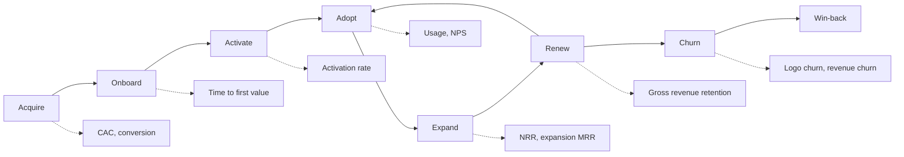
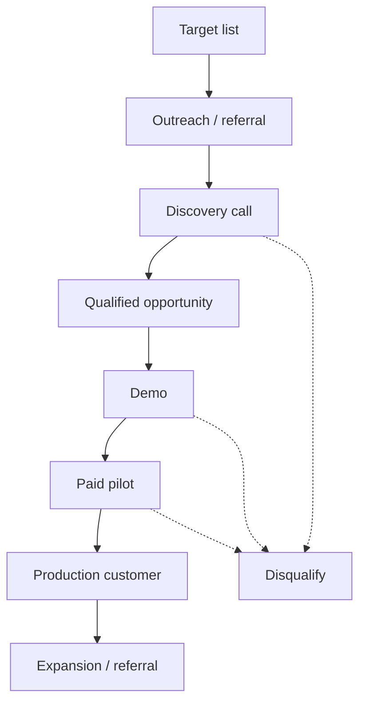
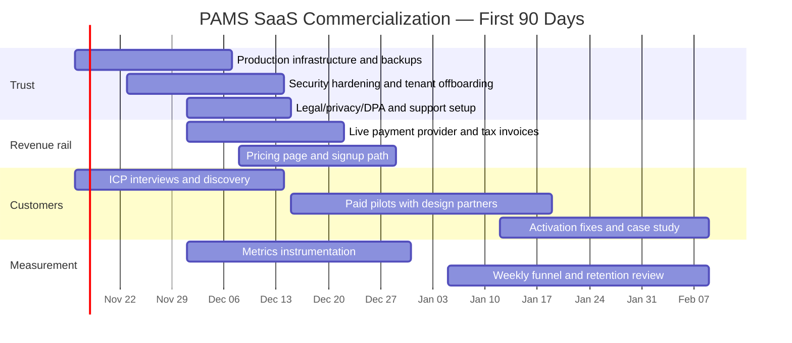
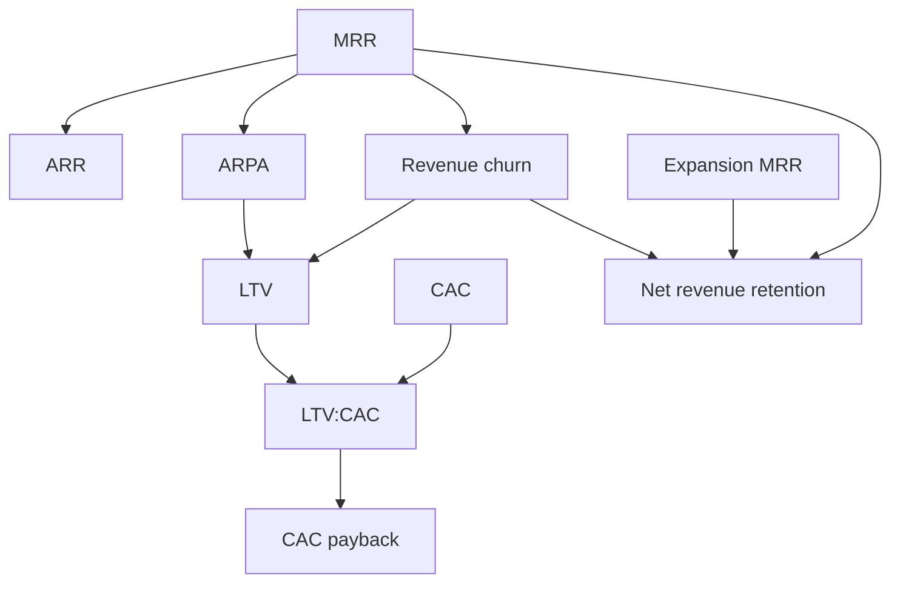

# PAMS SaaS Commercialization Roadmap

> **Purpose:** This is the operating plan for turning PAMS from a technically complete procurement
> application into a repeatable, revenue-generating SaaS business. Use it as the reference when
> choosing what to build, what to sell, and which numbers to watch.
>
> **Status:** Living document. Update it as customer evidence, pricing decisions and production
> constraints become clearer.
>
> **Related docs:** `docs/REQUIREMENTS.md`, `docs/ARCHITECTURE.md`, `docs/DECISIONS.md`,
> `docs/SECURITY.md`, `docs/RUNBOOK.md`, `docs/SUBSCRIPTION_BILLING.md`.

---

## Contents

1. [Executive Summary](#1-executive-summary)
2. [Commercial Principles](#2-commercial-principles)
3. [Target Market and Positioning](#3-target-market-and-positioning)
4. [SaaS Lifecycle](#4-saas-lifecycle)
5. [Phase A — Production Readiness](#5-phase-a--production-readiness)
6. [Phase B — First Paying Customers](#6-phase-b--first-paying-customers)
7. [Phase C — Monetization and Differentiation](#7-phase-c--monetization-and-differentiation)
8. [Phase D — Sales and Repeatability](#8-phase-d--sales-and-repeatability)
9. [Phase E — Scale](#9-phase-e--scale)
10. [Ninety-Day Execution Plan](#10-ninety-day-execution-plan)
11. [The 5 Core SaaS Metrics](#11-the-5-core-saas-metrics)
12. [Pricing and Packaging](#12-pricing-and-packaging)
13. [Payments, Tax and Local Market Readiness](#13-payments-tax-and-local-market-readiness)
14. [Security, Compliance and Trust](#14-security-compliance-and-trust)
15. [Risks and Mitigations](#15-risks-and-mitigations)
16. [Immediate Next Actions](#16-immediate-next-actions)
17. [Definition of SaaS Commercial Readiness](#17-definition-of-saas-commercial-readiness)

---

## 1. Executive Summary

PAMS already contains the hard product primitives:

- Multi-tenant procurement requests, approvals, budgets, vendors, POs, receipts and invoices
- Permission-based roles, tenant isolation, audit trails and workflow configuration
- SaaS plans, feature entitlements, Stripe test billing, MRR analytics and tenant administration
- Tenant onboarding, Keycloak provisioning and branding customization

The remaining gap is **commercial readiness**:

- Production trust: security, backups, observability, legal/compliance, support
- Self-service or assisted acquisition: pricing page, trial signup, onboarding
- Real payment rails for the target market, including tax-ready invoices
- Tenant lifecycle: export, cancellation, deletion and restoration
- Repeatable sales motion and metric instrumentation

The fastest path to revenue is not another dashboard. It is:

1. A narrow customer segment with a painful, budgeted procurement problem
2. A reliable production service they trust
3. A payment method they can actually use
4. Direct conversations that convert into paid pilots
5. Retention and expansion driven by measurable customer value

### Commercial Readiness Scorecard

| Capability | Current State | Commercial Requirement |
|---|---|---|
| Core procurement product | Strong | Keep stable; fix customer-reported blockers |
| Subscription and entitlement model | Strong foundation | Live billing, tax, dunning, refunds, annual plans |
| Tenant onboarding | Platform-admin assisted | Add self-serve or concierge onboarding path |
| Tenant offboarding | Weak | Data export, cancellation, deletion/anonymization |
| Production operations | Partial | Backups, monitoring, alerts, DR drills, status page |
| Security and compliance | Partial | Pen test, DPA, privacy policy, retention policy |
| Support | Weak | Help center, support inbox, SLA, onboarding checklist |
| Sales and marketing | Not started | ICP, pricing page, demo, paid pilot, CRM |
| Retention analytics | Partial | Churn, activation, cohorts, CAC, LTV, NRR |
| Payment rails | Test mode only | Market-appropriate live provider and tax invoices |

**Readiness rule:** do not scale paid acquisition until production security, billing,
support and tenant offboarding are credible enough that a paying customer would trust you with
business-critical procurement data.

---

## 2. Commercial Principles

These principles prevent the most common SaaS failure mode: building for months without a buyer.

1. **Sell before overbuilding.** Talk to potential customers before adding large features.
2. **Pick a narrow ICP.** “Everyone who buys things” is not a market. Start with one segment.
3. **Charge from the first pilot.** Free pilots create feedback but rarely create revenue urgency.
4. **Solve a budgeted pain.** Lost approvals, uncontrolled spend, audit failures and Excel chaos
   are stronger buying triggers than “nice dashboards.”
5. **Measure activation, not signups.** A tenant is not a customer until its team uses approvals,
   POs or budgets in a real workflow.
6. **Protect gross margin.** Support burden and manual onboarding can destroy a low-price SaaS.
7. **Keep procurement data safe.** Trust is the product. A single tenant-isolation failure can end
   the business.
8. **Prefer boring reliability over clever features.** Customers pay for uptime, clarity and support.
9. **Make expansion natural.** Seats, departments, storage, integrations and enterprise controls
   should expand revenue without a new sales cycle.
10. **Do not compete on price.** Compete on speed to value, local fit, support and workflow depth.

---

## 3. Target Market and Positioning

### 3.1 Ideal Customer Profile (ICP) Worksheet

Choose one primary segment first. Fill this in with customer evidence, not assumptions.

| Question | Working Answer |
|---|---|
| Who feels the pain most? | Organizations with recurring purchases and approval bottlenecks |
| Company size | 20–500 staff, 2+ departments, recurring procurement |
| Geography | Start local/regional where you can support customers directly |
| Current tools | Excel, email, WhatsApp, shared drives, basic accounting software |
| Buying trigger | Audit finding, budget overrun, growth, donor compliance, new finance leadership |
| Economic buyer | Owner, CFO, Finance Director, Operations Director, COO |
| Daily users | Requesters, approvers, procurement officers, finance |
| Success metric | Approval cycle time, spend visibility, budget control, audit readiness |
| Budget range | Validate willingness to pay before setting public pricing |

### 3.2 Candidate Segments

Evaluate these with real interviews:

- SMEs with recurring procurement but no ERP
- NGOs and donor-funded programmes requiring procurement evidence
- Schools, clinics and multi-branch service businesses
- Construction, engineering and professional services firms
- Franchises and distributors with centralized purchasing
- Growing companies outgrowing spreadsheets and email approvals

### 3.3 Positioning Statement Template

> For **[target organization]** who struggle with **[specific procurement pain]**, PAMS is a
> **[category]** that **[primary outcome]**. Unlike **[alternative]**, PAMS **[differentiator]**.

Example:

> For growing mid-sized organizations who lose control of purchases across departments, PAMS is a
> procurement and approval platform that gives finance a complete, auditable request-to-payment
> trail. Unlike spreadsheets and email threads, PAMS enforces budgets and approvals before money is
> committed.

### 3.4 Discovery Questions

Ask these before building more product:

- Walk me through your last purchase request from request to payment.
- Where does it get stuck? Who chases whom?
- What happens when a budget is exceeded?
- How do you prove who approved what?
- What does an audit or donor review ask you to produce?
- What tools do you use today, and what do you pay for them?
- What would make you switch in the next 90 days?
- Who signs the cheque, and what would justify the price?
- What would make you reject PAMS immediately?

---

## 4. SaaS Lifecycle



### Stage Definitions

| Stage | Meaning | Evidence |
|---|---|---|
| Acquire | Prospect discovers PAMS | Website visit, demo request, referral |
| Onboard | Tenant and admin created | Provisioning active, first login |
| Activate | Real workflow completed | First submitted request, approval or PO |
| Adopt | Team uses PAMS repeatedly | Weekly active users, multiple departments |
| Expand | More seats/features/usage | Plan upgrade, more users, more requests |
| Renew | Paid subscription continues | Successful renewal invoice |
| Churn | Subscription ends | Cancellation or non-payment |
| Win-back | Former customer returns | New paid subscription |

---

## 5. Phase A — Production Readiness

**Goal:** Make PAMS trustworthy enough for a paying customer’s business-critical data.

### 5.1 Infrastructure and Operations

- [ ] Production and staging environments separated
- [ ] Managed PostgreSQL with automated backups and point-in-time recovery
- [ ] Tested restore procedure and documented RPO/RTO
- [ ] MinIO/object-storage backup and lifecycle policy
- [ ] Redis persistence/HA decision documented
- [ ] Secrets manager or encrypted secret store; no production secrets in `.env`
- [ ] TLS everywhere, HSTS and secure cookies
- [ ] Keycloak in production mode with its own database backup
- [ ] Keycloak service account working without master-admin fallback
- [ ] Reverse proxy, request size limits, rate limits and WAF/edge protection
- [ ] Uptime monitoring, synthetic checks and on-call alerting
- [ ] Error tracking with release/version tagging
- [ ] Centralized logs with retention and PII redaction
- [ ] Status page and incident response runbook
- [ ] Load test at expected peak plus headroom
- [ ] CI/CD with staging promotion and rollback procedure

### 5.2 Security and Compliance

- [ ] Independent penetration test before first production customer
- [ ] Tenant-isolation test for every endpoint and report
- [ ] RLS enabled and verified on every tenant-owned table
- [ ] Audit-log retention and access policy
- [ ] DPA, privacy policy and terms of service
- [ ] Data export and tenant deletion/anonymization
- [ ] Backup encryption and restore access audit
- [ ] Dependency and container scanning in CI
- [ ] Rate limits for login, invitations, uploads and exports
- [ ] Incident response plan and breach notification process

### 5.3 Billing Readiness

- [ ] Live payment provider verified for the target country
- [ ] Tax/VAT handling and compliant invoices
- [ ] Refund, credit-note and chargeback process
- [ ] Dunning, grace periods and cancellation communications
- [ ] Annual billing and upgrade/downgrade policy
- [ ] Revenue recognition and accounting export
- [ ] Subscription reconciliation audit
- [ ] Payment failure and recovery playbook

### 5.4 Tenant Lifecycle

- [ ] Export all tenant data in a usable format
- [ ] Cancel subscription and retain read-only access policy
- [ ] Delete/anonymize tenant data on request
- [ ] Restore accidentally suspended tenants
- [ ] Usage and limit visibility
- [ ] Seat management and overage policy

### Phase A Exit Criteria

PAMS is production-ready when:

- A customer can be backed up, restored and offboarded without manual database edits.
- No endpoint leaks across tenants.
- A payment failure does not silently preserve full access indefinitely.
- An on-call engineer can detect and respond to an incident using documented procedures.

---

## 6. Phase B — First Paying Customers

**Goal:** Acquire and activate the first 5–10 paying customers, even if onboarding is assisted.

### 6.1 Acquisition and Onboarding

Start with **concierge onboarding** if self-serve would take months.

- [ ] Public pricing page with clear plan comparison
- [ ] Trial/checkout entry point
- [ ] Tenant setup wizard: organization, admin, first department
- [ ] Approval policy starter template
- [ ] Guided first request or sample data
- [ ] Activation checklist in-app
- [ ] Invite team members and assign roles
- [ ] Billing setup and invoice access

### 6.2 Activation Definition

A tenant is activated only when a real workflow is completed. Example activation event:

> Tenant has at least 1 active admin, 2 departments, 1 approval policy, 1 submitted request
> approved, and 1 purchase order issued within 30 days.

Track time-to-first-value and where onboarding stalls.

### 6.3 Support

- [ ] Support email/ticketing
- [ ] Help center and FAQs
- [ ] Onboarding checklist
- [ ] Known issues page
- [ ] SLA for paid plans
- [ ] Customer feedback loop and release notes

### Phase B Exit Criteria

- Five paying customers have completed a real procurement workflow.
- You know the top three reasons prospects buy and the top three reasons they hesitate.
- Onboarding can be repeated in under one day per customer.

---

## 7. Phase C — Monetization and Differentiation

**Goal:** Increase willingness to pay and reduce churn through features customers explicitly value.

Do not build this list wholesale. Prioritize based on paid customer evidence.

### High-Value Candidates

- Supplier portal and quote comparison
- Mobile-friendly approvals
- Email-to-request intake
- Invoice OCR and document capture
- Accounting/ERP integrations
- Slack/Teams/WhatsApp approval notifications
- SSO/SAML and enterprise identity controls
- Audit export and compliance packs
- Custom domains
- Delegation and out-of-office rules
- Budget forecasting and spend analytics
- Contract and renewal tracking
- Multi-currency, localized taxes and local payment rails
- Procurement templates by industry

### Phase C Exit Criteria

- At least one premium feature has caused an upgrade or expansion.
- Gross margin remains healthy after support and infrastructure costs.
- Customers can articulate the value in one sentence.

---

## 8. Phase D — Sales and Repeatability

**Goal:** Turn a founder-led sales process into a repeatable motion.

### 8.1 Sales Assets

- [ ] One-page ICP and value proposition
- [ ] 10-slide demo deck
- [ ] 20-minute demo script
- [ ] Pricing and packaging sheet
- [ ] Security/trust page
- [ ] Customer case study
- [ ] Proposal and pilot agreement template
- [ ] CRM pipeline and follow-up cadence

### 8.2 Sales Funnel



### 8.3 Pricing Model

Choose a value metric customers understand:

- Active users
- Procurement spend under management
- Departments/locations
- Request volume
- Premium features such as SSO, audit export, custom domains

Example packaging:

| Plan | Target | Indicative Price | Included |
|---|---|---|---|
| Starter | Small teams | $29–$49/month | Core requests, approvals, vendors, POs |
| Growth | Growing SMEs | $99–$199/month | Receipts, invoices, webhooks, advanced reports |
| Enterprise | Larger organizations | $399–$999+/month | SSO, audit export, custom branding, support |

Validate prices with real buyers. Annual plans should improve cash flow and reduce churn.

### Phase D Exit Criteria

- Sales cycle and conversion rate are measurable.
- CAC and payback are understood.
- Monthly churn is below the target threshold.
- At least one reference customer will speak publicly.

---

## 9. Phase E — Scale

- Customer success and churn prevention
- Expansion revenue and account management
- Partner/referral programme
- Regional pricing and currencies
- SOC 2 / ISO 27001 if required by larger buyers
- Multi-region and disaster recovery
- Sales team and CRM discipline
- Financial model: CAC, LTV, gross margin, churn, NRR
- Support tiering and SLAs
- Product analytics and experimentation

---

## 10. Ninety-Day Execution Plan



### Weeks 1–3

- Production environment, backups, monitoring and security hardening
- Live payment provider/tax strategy
- Tenant export/deletion
- Support email and help center

### Weeks 4–6

- Public pricing and assisted signup
- Onboarding checklist
- First 10 customer interviews
- Define ICP and pricing hypotheses

### Weeks 7–9

- Paid pilots with 3–5 design partners
- Fix only the blockers they report
- Build one integration/feature they will pay for

### Weeks 10–12

- Repeatable demo and sales script
- Case study from first customer
- Improve activation and trial conversion
- Decide whether to stay niche or expand

---

## 11. The 5 Core SaaS Metrics

These are the five headline numbers to review every week. They connect directly to the SaaS
lifecycle and should drive product, sales and support decisions.

### 11.1 Metric Definitions

| # | Metric | Definition | Formula | What It Tells You |
|---|---|---|---|---|
| 1 | **MRR** | Monthly recurring revenue from active paying subscriptions | Sum of active monthly-normalized subscription value (annual plans ÷ 12) | Current revenue scale |
| 2 | **ARR** | Annualized recurring revenue | `MRR × 12` | Annual run-rate and valuation context |
| 3 | **Churn** | Lost revenue/customers over a period | `Lost MRR ÷ Starting MRR × 100`; also track logo churn | Retention and product fit |
| 4 | **CAC** | Cost to acquire one paying customer | `(Sales + Marketing + onboarding cost) ÷ New paying customers` | Sales efficiency |
| 5 | **LTV** | Lifetime gross profit expected from a customer | `ARPA × gross margin % ÷ monthly revenue churn %` | Long-term customer value |

### 11.2 Metric Tree



### 11.3 MRR Movement

Net new MRR is more useful than a single revenue total:

```text
Net New MRR = New MRR + Expansion MRR - Contraction MRR - Churned MRR
```

| Movement | Meaning |
|---|---|
| New MRR | First paid subscription from a new tenant |
| Expansion MRR | Upgrades, more seats, more usage, add-ons |
| Contraction MRR | Downgrades or reduced usage |
| Churned MRR | Canceled or expired paid subscriptions |

### 11.4 Targets and Guardrails

Use targets as hypotheses until real data exists.

| Metric | Healthy Direction | Example Guardrail |
|---|---|---|
| MRR | Growing every month | Positive net new MRR |
| ARR | Growing with MRR | Consistent with contracted revenue |
| Monthly logo churn | Low | < 2–3% for SMB; lower for mid-market |
| Revenue churn | Low | Net revenue retention > 100% |
| CAC payback | Short | < 12 months |
| LTV:CAC | High | 3:1 to 5:1 |
| Gross margin | High | > 75% after infrastructure/support |

### 11.5 What PAMS Already Measures

The Platform → Revenue page already provides:

- MRR and ARR
- ARPU
- Paying and trialing tenants
- Trial pipeline MRR
- At-risk/past-due MRR
- Plan mix and status mix
- Upcoming renewals
- Daily MRR snapshots and 30-day change

### 11.6 Metrics Instrumentation Backlog

To make all five metrics reliable, add:

- [ ] Acquisition source and campaign on tenant/prospect records
- [ ] Sales and marketing spend ledger for CAC
- [ ] Trial start, activation and conversion timestamps
- [ ] Cancellation reason and cancellation date
- [ ] Expansion/downgrade event history
- [ ] Gross margin inputs: hosting, support, payment fees
- [ ] Cohort retention and trial conversion charts
- [ ] Monthly board-style metrics summary

### 11.7 Weekly Operating Cadence

Review every Monday:

1. New trials and activations
2. New paying customers and MRR movement
3. Churn, past-due accounts and support escalations
4. Sales pipeline and conversion
5. Top product blockers from customers
6. One decision to improve activation, retention or pricing

---

## 12. Pricing and Packaging

### 12.1 Pricing Principles

- Price on customer value, not your development effort.
- Charge more for finance controls, auditability, SSO and support.
- Keep the entry plan simple enough to buy without a long procurement process.
- Use annual billing to improve cash flow and reduce churn.
- Avoid unlimited everything at low prices; support costs scale.

### 12.2 Example Revenue Math

| Average Price | Customers for ~$10k MRR |
|---|---:|
| $29/month | 345 |
| $99/month | 101 |
| $299/month | 34 |
| $499/month | 21 |

A focused B2B niche at $199–$499/month is more realistic than chasing thousands of low-price users
with high support costs.

### 12.3 Expansion Levers

- More active users
- Additional departments/locations
- Higher request volume
- Storage and attachments
- Premium reports and audit export
- SSO and enterprise security
- Custom branding and custom domains
- Integrations and priority support

---

## 13. Payments, Tax and Local Market Readiness

Test-mode Stripe is not sufficient for revenue in every market.

### 13.1 Validate the Payment Rail

- Can Stripe onboard your business and currency?
- If not, evaluate Flutterwave, DPO, Paystack, mobile money or bank transfer.
- Can customers pay by card, mobile money, bank transfer or invoice?
- What is the settlement time and fee?
- What happens when a payment fails or a customer disputes a charge?

### 13.2 Tax and Invoices

- VAT/sales tax rules for your jurisdiction
- Compliant invoice numbering and seller details
- Credit notes and refunds
- Accounting export
- Revenue recognition policy

### 13.3 Local Fit

- Local currency pricing may convert better than USD-only pricing.
- Bank transfer/manual payment reconciliation may be required.
- Support hours and language matter.
- On-premise/private deployment may be required by some enterprises later.

---

## 14. Security, Compliance and Trust

Trust is a sales asset, not only an engineering concern.

- Publish a security/trust page
- Maintain a data processing agreement and subprocessor list
- Define retention and deletion policies
- Provide tenant data export
- Log privileged platform actions
- Restrict production access and rotate secrets
- Run restore drills
- Document incident response and breach notification
- Obtain a penetration test before enterprise sales
- Consider SOC 2/ISO 27001 only when buyers require it

---

## 15. Risks and Mitigations

| Risk | Impact | Mitigation |
|---|---|---|
| Building features nobody pays for | Burn time and money | Interview buyers; sell pilots first |
| Payment provider cannot serve target market | No revenue collection | Validate rails before GTM |
| Tenant data leak | Existential | RLS, isolation tests, pen test |
| Low-price/high-support economics | Negative gross margin | Raise prices or narrow ICP |
| Trial signups never activate | Poor conversion | Onboarding checklist and concierge help |
| No retention measurement | Cannot fix churn | Instrument activation/churn and review weekly |
| Key-person dependency | Business continuity | Documentation, runbooks, automation |
| Compliance requirements block enterprise | Lost deals | Build trust pack and controls early |
| Too many custom requests | Product sprawl | Prioritize paid evidence, not loudest request |

---

## 16. Immediate Next Actions

### Top Five

1. Pick one ICP and interview 15–20 buyers.
2. Make production secure, observable, backed up and restorable.
3. Establish a real payment/tax path for the target market.
4. Add tenant export/deletion and support workflows.
5. Run a paid pilot instead of building more polish.

### Engineering Backlog

1. Production infrastructure and backup/restore drill
2. Tenant export/delete
3. Live billing and tax-ready invoices
4. Signup/trial onboarding flow
5. Activation events and metrics instrumentation
6. Help center and support workflow
7. Custom domain or local payment integration, if customers require it
8. Security review and penetration test

### Commercial Backlog

1. ICP and positioning statement
2. Pricing hypothesis and packaging
3. Demo script and sales deck
4. 20-prospect outreach list
5. Paid pilot agreement
6. First case study
7. Referral loop

---

## 17. Definition of SaaS Commercial Readiness

PAMS is ready to sell repeatedly when:

- A new customer can sign up or be onboarded without database access.
- Billing, taxes, invoices, refunds and dunning are operational.
- Tenant data can be exported and deleted on request.
- Backups have been restored successfully in a drill.
- Security isolation is independently tested.
- Support has a documented intake and response process.
- Activation and churn are measured weekly.
- At least five paying customers have completed a real procurement workflow.
- One customer will act as a reference.

Until these are true, prioritize trust, activation and sales learning over new UI polish.
