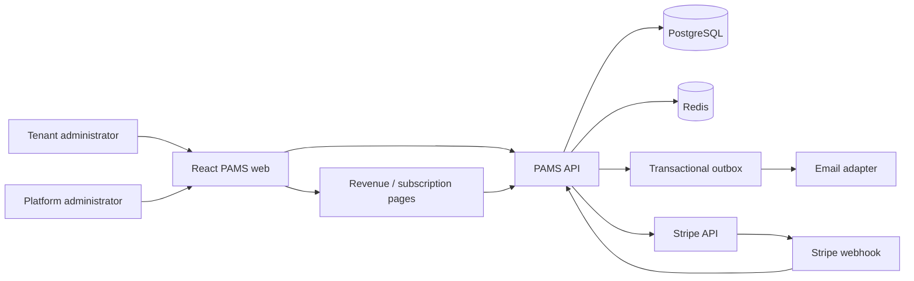
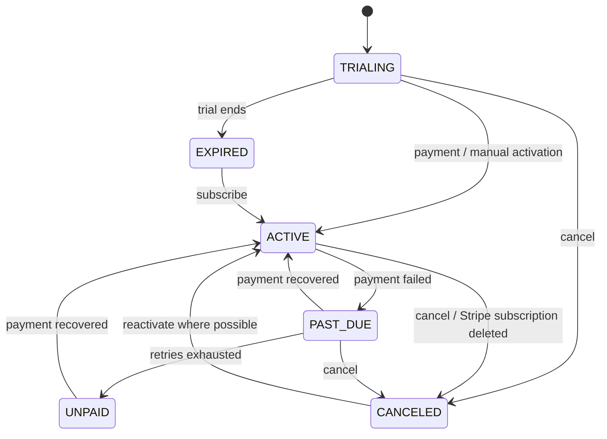
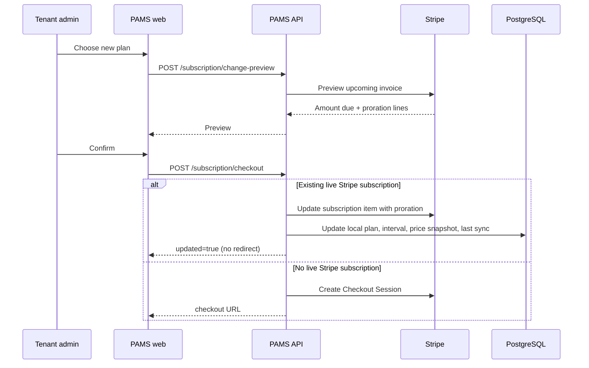

# PAMS Subscription & Stripe Billing

> **Purpose:** Document what PAMS and Stripe currently handle, how the billing lifecycle works,
> which critical issues have already been addressed, and what remains before live commercial use.
>
> **Status:** Implemented foundation with Stripe test-mode validation. Not yet a complete
> production billing operation.
>
> **Related:** `docs/SAAS_ROADMAP.md`, `docs/DECISIONS.md`, `docs/ARCHITECTURE.md`.

---

## Contents

1. [Summary](#1-summary)
2. [High-Level Architecture](#2-high-level-architecture)
3. [Data Model](#3-data-model)
4. [Plans and Entitlements](#4-plans-and-entitlements)
5. [Tenant Billing Flow](#5-tenant-billing-flow)
6. [Platform Subscription Administration](#6-platform-subscription-administration)
7. [Stripe Features Currently Used](#7-stripe-features-currently-used)
8. [Analytics and Revenue Metrics](#8-analytics-and-revenue-metrics)
9. [Lifecycle Automation and Notifications](#9-lifecycle-automation-and-notifications)
10. [Critical Issues Already Addressed](#10-critical-issues-already-addressed)
11. [Current Limitations and Follow-ups](#11-current-limitations-and-follow-ups)
12. [Configuration](#12-configuration)
13. [Security and Tenant Isolation](#13-security-and-tenant-isolation)
14. [Testing](#14-testing)
15. [Operational Checklist Before Live Billing](#15-operational-checklist-before-live-billing)
16. [Source Map](#16-source-map)

---

## 1. Summary

PAMS implements a multi-tenant SaaS subscription layer on top of Stripe. PAMS owns the commercial
model, tenant-facing plan experience, entitlements, usage limits, lifecycle state and analytics.
Stripe owns payment collection, recurring Stripe subscriptions, hosted checkout, billing portal and
payment-status webhooks.

| Responsibility | PAMS | Stripe |
|---|---|---|
| Plan catalogue and pricing metadata | Yes | Stores price IDs used by Stripe |
| Plan feature catalogue and mapping | Yes | No |
| Tenant subscription record | Yes | Mirror through customer/subscription IDs |
| Trial lifecycle | Yes | Optional Stripe trial support |
| Usage limits | Yes | No |
| Feature entitlements and gating | Yes | No |
| Hosted Checkout | Initiates | Yes |
| Card entry, SCA/3DS and payment methods | No | Yes |
| Recurring invoicing | Consumes webhooks | Yes |
| Proration calculation | Requests preview and applies changes | Yes |
| Billing portal | Links to it | Yes |
| Payment failure status | Mirrors and enforces grace | Emits events |
| MRR/ARR analytics | Yes | Not exposed as PAMS analytics |
| Subscription administration UI | Yes | Stripe dashboard separately |
| Tax, coupons, refunds, accounting | Not integrated | Stripe platform capability, not configured by PAMS |
| Tenant provisioning / Keycloak onboarding | Yes | No |
| Branding and feature entitlements | Yes | No |

---

## 2. High-Level Architecture



### Core modules

- `subscription/application/SubscriptionService` — plans, subscription state, checkout, portal,
  webhook handling, MRR, reconciliation and plan changes.
- `subscription/application/SubscriptionAccessService` — trial/active/past-due access checks and
  usage limits.
- `subscription/application/SubscriptionFeatureService` — feature catalogue and plan mappings.
- `subscription/application/SubscriptionLifecycleService` — trial/dunning/cancellation notices.
- `subscription/application/SubscriptionMrrSnapshotJob` — daily MRR snapshots.
- `platform/application/PlatformTenantService` — tenant creation and provisioning.
- `organization/application/TenantBrandingService` — Enterprise branding and terminology.
- `identity/infrastructure/KeycloakAdminAdapter` — tenant/admin user provisioning.

---

## 3. Data Model

### 3.1 `subscription_plan`

| Column | Meaning |
|---|---|
| `code` | Stable plan code (`STARTER`, `GROWTH`, `ENTERPRISE`) |
| `name`, `description` | Customer-facing plan identity |
| `monthly_price`, `annual_price`, `currency` | Current catalogue prices |
| `trial_days` | Default trial length |
| `max_users`, `max_departments`, `max_requests_month`, `max_storage_mb` | Usage limits; null = unlimited |
| `active` | Whether the plan is offered to new tenants/checkout |
| `sort_order` | Display order |
| `stripe_price_monthly`, `stripe_price_annual` | Stripe Price IDs |

Plans are managed through Platform → Subscription plans. Deactivation is soft: existing tenants keep
the plan, but it is hidden from new tenants and checkout. A plan assigned to tenants should not be
edited casually because new price metadata does not automatically migrate existing Stripe prices;
see the price-snapshot section.

### 3.2 `subscription_feature` and `subscription_plan_feature`

The feature catalogue is platform-managed and normalized. Each feature has:

- `code` (immutable lowercase identifier)
- `name`, `description`, category
- `active`
- `sort_order`

Each plan references selected feature codes through `subscription_plan_feature`. The old JSONB
feature array was migrated into this mapping and removed.

### 3.3 `tenant_subscription`

One row per tenant. Important fields:

| Field | Purpose |
|---|---|
| `plan_code` | Current plan |
| `status` | `TRIALING`, `ACTIVE`, `PAST_DUE`, `UNPAID`, `CANCELED`, `INCOMPLETE`, `EXPIRED` |
| `billing_interval` | `MONTHLY` or `ANNUAL` |
| `billing_source` | `TRIAL`, `STRIPE`, `MANUAL` |
| `stripe_customer_id`, `stripe_subscription_id` | Stripe references |
| `stripe_price_id` | Price currently applied |
| `monthly_price_snapshot`, `annual_price_snapshot`, `currency_snapshot` | Commercial terms at subscription time |
| `current_period_start/end` | Billing period mirrored from Stripe or local activation |
| `cancel_at_period_end` | Pending cancellation |
| `activated_at` | First paid/active moment |
| `last_stripe_sync_at` | Last successful reconciliation |
| trial reminder / payment-failed / canceled notification timestamps | Deduplication for lifecycle emails |

`version` supports optimistic locking.

### 3.4 Other tables

- `stripe_event` — idempotency ledger for webhook event IDs.
- `tenant_provisioning` — system-admin invite/provisioning state.
- `subscription_mrr_snapshot` — daily MRR/ARR/paying/trial/past-due/canceled snapshot.

### 3.5 Subscription state machine



`EXPIRED` is used for ended local trials. Stripe-managed trials remain governed by Stripe events.

---

## 4. Plans and Entitlements

Default plan seeds:

| Plan | Monthly/Annual | Users | Departments | Requests/month | Storage | Key features |
|---|---:|---:|---:|---:|---:|---|
| Starter | $29 / $290 | 10 | 3 | 100 | 2 GB | Requests, approvals, vendors, POs, core reports |
| Growth | $99 / $990 | 30 | 10 | 1,000 | 20 GB | Starter + receipts, invoices, webhooks, advanced reports |
| Enterprise | $299 / $2,990 | Unlimited | Unlimited | Unlimited | 100 GB | Growth + SSO, audit export, priority support, custom branding |

The exact feature set is controlled by the platform feature catalogue and plan mappings; the table is
the seed baseline, not a hardcoded runtime rule.

### 4.1 Feature enforcement

Enforced features currently include:

- `requests`
- `approvals`
- `vendors`
- `purchase_orders`
- `receipts`
- `invoices`
- `webhooks`
- `core_reports`
- `advanced_reports` (CSV export)
- `custom_branding`

Missing entitlement returns HTTP `403` with code `feature-not-enabled`. The tenant UI loads
`GET /api/v1/me/features` and hides routes/actions accordingly. `sso`, `audit_export` and
`priority_support` remain commercial/informational until their runtime capabilities are implemented.

### 4.2 Usage limits

`SubscriptionAccessService` enforces:

- Active users per plan
- Departments per plan
- Purchase requests submitted per calendar month
- Attachment storage in MB
- Write access during trial/active/past-due grace periods

The standard grace period for `PAST_DUE` is **7 days** from the current period end.

---

## 5. Tenant Billing Flow

### 5.1 First paid subscription

1. Tenant admin opens **Billing & subscription**.
2. PAMS creates or reuses the Stripe customer.
3. PAMS creates a Stripe Checkout Session with plan price and tenant metadata.
4. Stripe collects payment and returns to the PAMS billing page.
5. Stripe sends `checkout.session.completed` and subscription events.
6. PAMS marks the tenant `ACTIVE`, stores Stripe IDs/status/period and unlocks entitlements.

### 5.2 Existing Stripe subscription change



This prevents a second Stripe subscription from being created when an existing paid tenant changes
plan.

### 5.3 Billing portal

Tenant admins can open the Stripe Billing Portal for:

- Payment methods
- Invoices and receipts
- Subscription cancellation/renewal where configured in Stripe
- Customer billing details

PAMS does not act as the payment page.

---

## 6. Platform Subscription Administration

Platform admins have audited actions separate from tenant billing:

| Action | Behavior |
|---|---|
| Change plan/interval | Updates local terms; for Stripe-backed subscriptions also updates Stripe with proration |
| Extend trial | Local trial only; Stripe-managed trials must be extended in Stripe |
| Activate / mark paid | Manual/comped activation; rejected for Stripe-backed subscriptions |
| Cancel at period end | Updates Stripe when Stripe-backed |
| Cancel immediately | Deletes Stripe subscription when Stripe-backed, then marks local canceled |
| Reactivate | Clears cancellation when Stripe-backed; activates local manual subscriptions |
| Reconcile with Stripe | Re-reads Stripe subscription and repairs local plan/status/period/price |
| Run reconciliation audit | Reads all Stripe-backed subscriptions and reports mismatches |

All platform actions are audited through `platform_audit_event`.

---

## 7. Stripe Features Currently Used

### 7.1 Checkout

- Hosted Stripe Checkout for first subscription.
- Monthly and annual Price IDs.
- Tenant metadata (`organizationId`, `planCode`, `billingInterval`).
- Success/cancel URLs.

### 7.2 Billing Portal

- Hosted customer portal for payment methods and invoices.
- Return URL configured through `STRIPE_PORTAL_RETURN_URL`.

### 7.3 Customer and subscription APIs

- Create customer when needed.
- Read subscription and its billable item.
- Update subscription item for plan changes.
- Preview upcoming invoice for proration.
- Update cancellation/Reactivate.
- Delete subscription for immediate platform cancellation.

### 7.4 Webhook events handled

| Stripe event | PAMS effect |
|---|---|
| `checkout.session.completed` | Stores customer/subscription IDs, last sync |
| `customer.subscription.created` | Mirrors status, plan, interval, period, price |
| `customer.subscription.updated` | Mirrors status, plan, interval, period, cancellation |
| `customer.subscription.paused` | Maps to `PAST_DUE` |
| `customer.subscription.resumed` | Mirrors resumed state |
| `customer.subscription.deleted` | Marks `CANCELED` |
| `invoice.payment_failed` | Marks `PAST_DUE` |
| `invoice.payment_action_required` | Marks `PAST_DUE` |
| `invoice.paid` | Clears past-due status |
| `invoice.payment_succeeded` | Clears past-due status |
| `checkout.session.expired` | Acknowledged; no local subscription exists yet |

Webhook signatures are verified using `STRIPE_WEBHOOK_SECRET`; event IDs are idempotent through
`stripe_event`.

---

## 8. Analytics and Revenue Metrics

### 8.1 Revenue page

The platform Revenue page shows:

- MRR
- ARR
- ARPU
- Paying tenants
- Trials
- Trial pipeline MRR
- At-risk/past-due MRR
- New paying tenants in 30 days
- MRR by plan
- Subscription status mix
- Renewals in 30 days
- MRR trend from daily snapshots

### 8.2 MRR calculation

- Only `ACTIVE` subscriptions contribute to MRR.
- Annual plans are normalized monthly: `annual price / 12`.
- `PAST_DUE` and `UNPAID` are reported separately as at-risk MRR.
- `TRIALING` is reported separately as trial pipeline MRR.
- MRR uses per-subscription price snapshots, not the current plan catalogue price.
- Daily snapshots are written at 00:05 UTC by a ShedLock-protected job.

`snapshot` history starts when the feature is deployed; historical MRR before the first snapshot is
not fabricated.

---

## 9. Lifecycle Automation and Notifications

Daily lifecycle job at 07:15 UTC:

- Trial reminder at 7 days and 1 day remaining.
- Non-Stripe local trial expiry → `EXPIRED`.
- Past-due/canceled notification markers.
- Emails sent through the transactional outbox and branded subscription email template.

Stripe-driven trials and payment retries remain governed by Stripe configuration and webhooks. PAMS
does not implement its own card retry schedule.

---

## 10. Critical Issues Already Addressed

| Issue | Risk | Resolution |
|---|---|---|
| Plan changes created a second Stripe subscription | Double billing | Existing Stripe subscriptions now update their subscription item with proration |
| Platform actions changed local DB only | Local/Stripe drift | Stripe-backed plan/cancel/reactivate sync to Stripe; activation is rejected for Stripe-backed subs |
| Plan price edits changed local MRR while Stripe charged old price | Revenue misreporting | Billing-source and per-subscription price snapshots; MRR uses snapshots |
| No explicit billing source | Manual/Stripe/trial ambiguity | `billing_source` set to `TRIAL`, `STRIPE` or `MANUAL` |
| Missing payment-recovery events | Stuck `PAST_DUE` | `invoice.paid` and `invoice.payment_succeeded` clear past-due state |
| Trial expiry only blocked writes | Stale trial pipeline and no communication | `EXPIRED` state, daily lifecycle job and reminders |
| No dunning/cancellation emails | Customers surprised by loss of access | Outbox-backed payment-failed/cancelled/trial notices |
| Entitlements stayed stale after checkout | Upgrade appeared broken | Immediate invalidation plus 2s/5s/10s retries and 30s feature refresh |
| Feature codes were free text | Typo-based plan configuration | Normalized feature catalogue and plan mappings |
| Features were display-only | Plans did not control access | `@RequiresFeature` enforcement and `/me/features` UI gating |
| Platform admins inherited tenant subscription permissions | Cross-context confusion | Tenant `subscription:*` removed from `PLATFORM_ADMIN`; dedicated platform permissions |
| Plan price/feature UI was modal-heavy | Poor admin workflow | Page-first plan and subscription management |
| MRR had no history | Could not see trend | Daily `subscription_mrr_snapshot` |
| No way to repair Stripe drift | Manual SQL intervention | Individual Stripe reconcile and bulk audit |
| No proration visibility | Surprise invoices | Upcoming-invoice preview page before confirmation |
| No automated Stripe lifecycle regression | Recurrence risk | Opt-in real Stripe test-clock integration test (`make stripe-test-clock`) |
| Existing test-mode duplicate subscription | Double billing in test data | Identified and canceled manually; checkout path now prevents recurrence |

---

## 11. Current Limitations and Follow-ups

| Area | Current state | Recommended follow-up |
|---|---|---|
| Stripe live mode | Test mode only | Complete live onboarding, business verification and live webhook test |
| Tax/VAT | Not configured in PAMS | Stripe Tax or local tax engine; compliant invoices |
| Refunds / credits | Stripe dashboard | Add operational policy and accounting flow |
| Coupons / discounts | Not integrated | Decide whether to support promotions |
| Multi-currency | USD plans | Add locale/currency pricing if required by market |
| Card retry/dunning schedule | Stripe-controlled | Document and configure Stripe retry policy |
| Seats | Plan max users only | Add explicit seat quantity if selling per seat |
| Bulk reconciliation repair | Audit is read-only | Add reviewed bulk repair or automated sync job |
| Stripe event retention | No cleanup policy | Add retention/archival policy |
| Billing emails | PAMS sends lifecycle notices | Consider Stripe invoice/receipt email policy |
| Customer billing details | Customer created with name only | Collect billing email/address/tax ID where needed |
| Audit export | Feature exists, endpoint not implemented | Build export before enforcing `audit_export` |
| Entitlement runtime | Enforced for key modules | Add runtime enforcement for SSO and audit export when built |

---

## 12. Configuration

Relevant environment variables:

```env
STRIPE_SECRET_KEY=
STRIPE_WEBHOOK_SECRET=
STRIPE_SUCCESS_URL=http://localhost:3000/admin/billing?checkout=success
STRIPE_CANCEL_URL=http://localhost:3000/admin/billing?checkout=cancel
STRIPE_PORTAL_RETURN_URL=http://localhost:3000/admin/billing
```

Stripe Price IDs are stored on plan records and managed from the platform Subscription plans page.
The webhook endpoint is:

```text
POST /api/v1/webhooks/stripe
```

Local test listener:

```bash
stripe listen \
  --events checkout.session.completed,customer.subscription.created,customer.subscription.updated,customer.subscription.deleted,invoice.payment_failed \
  --forward-to localhost:8080/api/v1/webhooks/stripe
```

Stripe test-clock regression:

```bash
make stripe-test-clock
```

Requires `STRIPE_TEST_CLOCK_E2E=true` and `STRIPE_TEST_CLOCK_PRICE_ID` with a test-mode key.

---

## 13. Security and Tenant Isolation

- Subscription tables are platform/billing tables; tenant-facing access is explicit by
  `organization_id` from `TenantContext`.
- Tenant admins can access only their own subscription view and use `subscription:*` permissions.
- Platform admins use `platform:tenant_read`, `platform:tenant_manage` and
  `platform:analytics_read`; tenant subscription permissions were removed from `PLATFORM_ADMIN`.
- Webhook endpoint is public only for Stripe signature verification; nothing is trusted without a
  valid signature.
- `stripe_event` makes webhook processing idempotent.
- Missing Stripe configuration fails safely rather than creating unusable local subscriptions.
- Platform plan and lifecycle actions are audited; tenant-initiated Stripe changes are recorded by Stripe events.
- Stripe secrets are environment-only and never logged.

---

## 14. Testing

Backend integration tests cover:

- Subscription creation, trial, plan changes, activation, cancellation and reactivation
- Feature enforcement and `403 feature-not-enabled`
- Feature catalogue CRUD and plan selection
- MRR and reconciliation endpoints
- Lifecycle trial reminders/expiry and outbox events
- Billing-source/price snapshot behavior
- Subscription permission separation
- Tenant isolation

Stripe test-clock test is opt-in because it uses a real Stripe test account. It validates:
- Test-clock customer/subscription creation
- Renewal advancement after advancing the clock
- Local reconciliation after the renewal

Proration preview and existing-subscription updates are covered by the PAMS integration tests and
manual Stripe test-mode verification.

Frontend checks cover:
- Billing page and plan cards
- Proration preview page
- Feature entitlement gating
- Subscription management pages

---

## 15. Operational Checklist Before Live Billing

- [ ] Validate Stripe live onboarding and supported countries
- [ ] Configure live secret key and webhook secret
- [ ] Register production webhook endpoint and verify signatures
- [ ] Configure tax, invoices and seller details
- [ ] Decide invoice/receipt email ownership (Stripe vs PAMS)
- [ ] Configure dunning/retry policy in Stripe
- [ ] Test upgrade, downgrade, cancel, reactivate and payment failure
- [ ] Test duplicate webhook delivery
- [ ] Confirm price snapshots and MRR after live events
- [ ] Run reconciliation audit after the first live subscription
- [ ] Confirm tenant cancellation/deletion and data-retention policy
- [ ] Document support workflow for billing disputes and refunds

---

## 16. Source Map

| Concern | Source |
|---|---|
| Subscription API | `backend/src/main/java/com/company/procurement/subscription/api/SubscriptionController.java` |
| Stripe webhook API | `backend/src/main/java/com/company/procurement/subscription/api/StripeWebhookController.java` |
| Billing logic | `backend/src/main/java/com/company/procurement/subscription/application/SubscriptionService.java` |
| Access limits and feature checks | `backend/src/main/java/com/company/procurement/subscription/application/SubscriptionAccessService.java` |
| Feature catalogue | `backend/src/main/java/com/company/procurement/subscription/application/SubscriptionFeatureService.java` |
| Lifecycle notifications | `backend/src/main/java/com/company/procurement/subscription/application/SubscriptionLifecycleService.java` |
| MRR snapshot job | `backend/src/main/java/com/company/procurement/subscription/application/SubscriptionMrrSnapshotJob.java` |
| Platform subscription actions | `backend/src/main/java/com/company/procurement/platform/api/PlatformSubscriptionController.java` |
| Plan admin | `backend/src/main/java/com/company/procurement/platform/api/PlatformPlanController.java` |
| Feature admin | `backend/src/main/java/com/company/procurement/platform/api/PlatformFeatureController.java` |
| Schema | `V18`, `V20`, `V21`, `V22`, `V23` migrations |
| Tenant billing UI | `frontend/src/features/subscription/BillingPage.tsx` |
| Plan change preview | `frontend/src/features/subscription/PlanChangePreviewPage.tsx` |
| Platform revenue/subscriptions | `frontend/src/features/platform/PlatformSubscriptionsPage.tsx`, `TenantSubscriptionsTab.tsx` |
| Platform plans/features | `frontend/src/features/platform/PlatformPlansPage.tsx`, `PlatformFeatureFormPage.tsx` |
